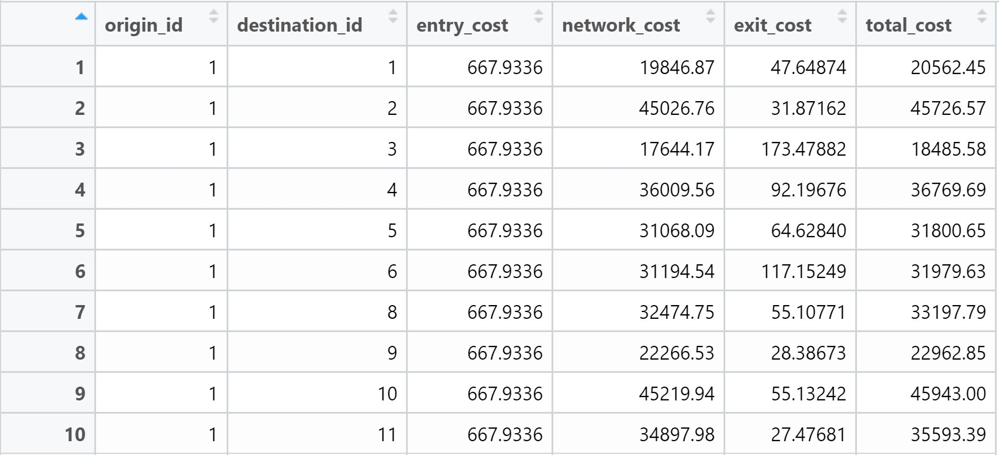
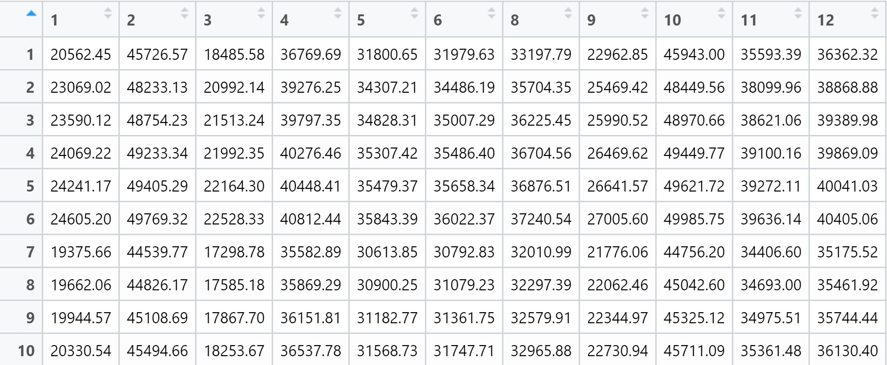

## 1. Getting Started

### 1.1 Dataset

Four data sets will be used in this hands-on exercise, they are:

- MP14_SUBZONE_NO_SEA_PL: URA Master Plan 2014 subzone boundary GIS data. This data set is downloaded from data.gov.sg.

- hexagons: A 250m radius hexagons GIS data. This data set was created by using st_make_grid() of sf package. It is in ESRI shapefile format.

- ELDERCARE: GIS data showing location of eldercare service. This data is downloaded from data.gov.sg. There are two versions. One in ESRI shapefile format. The other one in Google kml file format. For the purpose of this hands-on exercise, ESRI shapefile format is provided.

- OD_Matrix: a distance matrix in csv format. There are six fields in the data file. They are:

  - origin_id: the unique id values of the origin (i.e. fid of hexagon data set.);
  - destination_id: the unique id values of the destination (i.e. fid of ELDERCARE data set.);
  - entry_cost: the perpendicular distance between the origins and the nearest road);
  - network_cost: the actual network distance from the origin and destination;
  - exit_cost: the perpendicular distance between the destination and the nearest road); and
  - total_cost: the summation of entry_cost, network_cost and exit_cost. All the values of the cost related fields are in metres.

::: callout-note
## Note

Except for MP14_SUBZONE_NO_SEA_PL data set, the datasets were specially prepared by Prof. Kam for teaching and research purpose. Students taking IS415 Geospatial Analytics and Applications are allowed to use them for hands-on exercise purpose. Please obtain formal approval from Prof. Kam if you want to use them for other courses or usage.
:::

### 1.1 Installing R Packages

```{r}
pacman::p_load(tmap, SpatialAcc, sf, 
               ggstatsplot, reshape2,
               tidyverse)
```

## 2. Geospatial Data Wrangling

### 2.1 Importing geospatial data

st_read() of sf package is used to import three geospatial data: `MP14_SUBZONE_NO_SEA_PL`, `hexagons` and `ELDERCARE`.

```{r}
mpsz <- st_read(dsn = "data/geospatial", layer = "MP14_SUBZONE_NO_SEA_PL")
```

```{r}
hexagons <- st_read(dsn = "data/geospatial", layer = "hexagons") 
```

```{r}
eldercare <- st_read(dsn = "data/geospatial", layer = "ELDERCARE")
```

The report above shows that the R object used to contain the imported `MP14_SUBZONE_WEB_PL` shapefile is called `mpsz` and it is a simple feature object. The geometry type is multipolygon. it is also important to note that `mpsz` simple feature object does not have EPSG information.

### 2.2 Updating CRS information

```{r}
mpsz <- st_transform(mpsz, 3414)
eldercare <- st_transform(eldercare, 3414)
hexagons <- st_transform(hexagons, 3414)
```

After transforming the projection metadata, the projection can be verified through the newly transformed `mpsz_svy21` by using *st_crs()* of sf package.

```{r}
st_crs(mpsz)
```

### 2.3 Cleaning and updating attribute fields of the geospatial data

I will now exclude redundant fields from the data tables of `eldercare` and `hexagons`. At the same time, new fields called `demand` and `capacity` will be added into the data table of `hexagons` and `eldercare` sf data frame respectively. Both fields are derive using *mutate()* of dplyr package.

```{r}
eldercare <- eldercare %>%
  select(fid, ADDRESSPOS) %>%
  mutate(capacity = 100)
```

```{r}
hexagons <- hexagons %>%
  select(fid) %>%
  mutate(demand = 100)
```

A constant value of 100 is used for this exercise. In practice, actual demand of the hexagon and capacity of the eldercare centre should be used.

## 3. Aspatial Data Handling and Wrangling

### 3.1 Importing Distance Matrix

Using *read_cvs()* of readr package, I will import `OD_Matrix.csv` into RStudio. The imported object is a tibble data.frame called `ODMatrix`.

```{r}
ODMatrix <- read_csv("data/aspatial/OD_Matrix.csv", skip = 0)
```

### 3.2 Tidying distance matrix

The imported `ODMatrix` organised the distance matrix columnwise.



Whereas most modelling packages in R requires a different matrix.



The rows represent origins (i.e. also know as from field) and the columns represent destination (i.e. also known as to field.)

Instead of *spread()* of tidyr package, I will use *pivot_wider()*, which is a new function, to transform the O-D matrix from a thin format into a fat format.

```{r}
distmat <- ODMatrix %>%
  select(origin_id, destination_id, total_cost) %>%
  pivot_wider(names_from = destination_id, values_from = total_cost) %>%
  select(-origin_id)
```

Currently, the distance is measured in metre because SVY21 projected coordinate system is used. I will convert the unit f measurement from metre to kilometre.

```{r}
distmat_km <- as.matrix(distmat/1000)
```

## 4. Modelling and Visualising Accessibility using Hansen Method

### 4.1 Computing Hansen’s accessibility

Hansen’s accessibility will be computed using *ac()* of SpatialAcc package. *data.frame()* is used to save the output in a data frame called `acc_Handsen`.

```{r}
acc_Hansen <- data.frame(
  SpatialAcc::ac(
    hexagons$demand,
    eldercare$capacity,
    distmat_km,
    power = 2,
    family = "Hansen"
  )
)
```

::: callout-note
## Note

*SpatialAcc::ac()* was added to the provided code as I was encountering error without calling the SpatialAcc package explicitly. *d0 =* argument was also left out as it was commented out in the provided code.
:::

```{r}
colnames(acc_Hansen) <- "accHansen"
```

*bind_cols()* of dplyr will be used to join the `acc_Hansen` tibble data frame with the `hexagons` simple feature data frame. The output is called `hexagon_Hansen`.

```{r}
hexagon_Hansen <- bind_cols(hexagons, acc_Hansen)
```

Notice that `hexagon_Hansen` is a simple feature data frame and not a typical tibble data frame.

### 4.2 Visualising Hansen’s accessibility

I will extract the extend of hexagons simple feature data frame by by using *st_bbox()* of sf package.

```{r}
mapex <- st_bbox(hexagons)
```

I will use a collection of mapping functions of tmap package to create a high cartographic quality accessibility to eldercare centre in Singapore.

```{r}
tm_shape(hexagon_Hansen,
         bbox = mapex) + 
  tm_polygons(fill = "accHansen", 
              fill.scale = tm_scale_intervals(
                style = "quantile",
                n = 10,
                values = "brewer.blues")) +
tm_shape(eldercare) +
  tm_dots(size = 0.3,
          fill = "red",
          col = "black") +
  tm_title("Accessibility to eldercare: Hansen method") +
  tm_layout(frame = TRUE) +
  tm_compass(type="8star", size = 2) +
  tm_scalebar() +
  tm_grid(alpha = 0.2)
```

### 4.3 Statistical graphic visualisation

I will compare the distribution of Hansen’s accessibility values by URA Planning Region.

First, I will add the planning region field into `haxegon_Hansen` simple feature data frame.

```{r}
hexagon_Hansen <- st_join(hexagon_Hansen, mpsz, 
                          join = st_intersects)
```

Next, *ggplot()* will be used to plot the distribution by using boxplot graphical method.

```{r}
ggplot(data=hexagon_Hansen, 
       aes(y = log(accHansen), 
           x= REGION_N)) +
  geom_boxplot() +
  geom_point(stat="summary", 
             fun.y="mean", 
             colour ="red", 
             size=2)
```

## 5. Modelling and Visualising Accessibility using KD2SFCA Method

### 5.1 Computing KD2SFCA’s accessibility

I will calculate Hansen’s accessibility using *ac()* of SpatialAcc and *data.frame()* is used to save the output in a data frame called `acc_KD2SFCA`. Notice that KD2SFCA is used for family argument.

```{r}
acc_KD2SFCA <- data.frame(
  SpatialAcc::ac(
    hexagons$demand,
    eldercare$capacity,
    distmat_km, 
    d0 = 5,
    power = 2, 
    family = "KD2SFCA"
    )
)

colnames(acc_KD2SFCA) <- "accKD2SFCA"
acc_KD2SFCA <- as_tibble(acc_KD2SFCA)
hexagon_KD2SFCA <- bind_cols(hexagons, acc_KD2SFCA)
```

::: callout-note
## Note

*SpatialAcc::ac()* was added to the provided code as I was encountering error without calling the SpatialAcc package explicitly.
:::

### 5.2 Visualising KD2SFCA’s accessibility

I will use a collection of mapping fucntions of tmap package to create a high cartographic quality accessibility to eldercare centre in Singapore. Notice that *mapex* is reused for bbox argument.

```{r}
tm_shape(hexagon_KD2SFCA,
         bbox = mapex) + 
  tm_polygons(fill = "accKD2SFCA", 
              fill.scale = tm_scale_intervals(
                style = "quantile",
                n = 10,
                values = "brewer.blues")) +
tm_shape(eldercare) +
  tm_dots(size = 0.3,
          fill = "red",
          col = "black") +
  tm_title("Accessibility to eldercare: KD2SFCA method") +
  tm_layout(frame = TRUE) +
  tm_compass(type="8star", size = 2) +
  tm_scalebar() +
  tm_grid(alpha = 0.2)
```

### 5.3 Statistical graphic visualisation

I will compare the distribution of KD2CFA accessibility values by URA Planning Region.

First, I will add the planning region field into `hexagon_KD2SFCA` simple feature data frame.

```{r}
hexagon_KD2SFCA <- st_join(hexagon_KD2SFCA, mpsz, 
                          join = st_intersects)
```

Next, *ggplot()* will be used to plot the distribution by using boxplot graphical method.

```{r}
#| eval: false
ggplot(data=hexagon_KD2SFCA, 
       aes(y = accKD2SFCA, 
           x = REGION_N.x)) +
  geom_boxplot() +
  geom_point(stat="summary", 
             fun.y="mean", 
             colour ="red", 
             size=2)
```

## 6. Modelling and Visualising Accessibility using Spatial Accessibility Measure (SAM) Method

### 6.1 Computing SAM accessibility

I will calculates Hansen’s accessibility using *ac()* of SpatialAcc and *data.frame()* is used to save the output in a data frame called `acc_SAM`. Notice that *SAM* is used for family argument.

```{r}
acc_SAM <- data.frame(
  SpatialAcc::ac(
    hexagons$demand,
    eldercare$capacity,
    distmat_km, 
    d0 = 5,
    power = 2, 
    family = "SAM"
    )
)

colnames(acc_SAM) <- "accSAM"
acc_SAM <- as_tibble(acc_SAM)
hexagon_SAM <- bind_cols(hexagons, acc_SAM)
```

::: callout-note
## Note

*SpatialAcc::ac()* was added to the provided code as I was encountering error without calling the SpatialAcc package explicitly.
:::

### 6.2 Visualising SAM’s accessibility

I will use a collection of mapping fucntions of tmap package to create a high cartographic quality accessibility to eldercare centre in Singapore. Notice that *mapex* is reused for bbox argument.

```{r}
tm_shape(hexagon_SAM,
         bbox = mapex) + 
  tm_polygons(fill = "accSAM", 
              fill.scale = tm_scale_intervals(
                style = "quantile",
                n = 10,
                values = "brewer.blues")) +
tm_shape(eldercare) +
  tm_dots(size = 0.3,
          fill = "red",
          col = "black") +
  tm_title("Accessibility to eldercare: SAM method") +
  tm_layout(frame = TRUE) +
  tm_compass(type="8star", size = 2) +
  tm_scalebar() +
  tm_grid(alpha = 0.2)
```

### 6.3 Statistical graphic visualisation

I will now compare the distribution of SAM accessibility values by URA Planning Region.

First, I will add the planning region field into `hexagon_SAM` simple feature data frame by using the code chunk below.

```{r}
hexagon_SAM <- st_join(hexagon_SAM, mpsz, 
                       join = st_intersects)
```

Next, *ggplot()* will be used to plot the distribution by using boxplot graphical method.

```{r}
ggplot(data=hexagon_SAM, 
       aes(y = accSAM, 
           x= REGION_N)) +
  geom_boxplot() +
  geom_point(stat="summary", 
             fun.y="mean", 
             colour ="red", 
             size=2)
```
