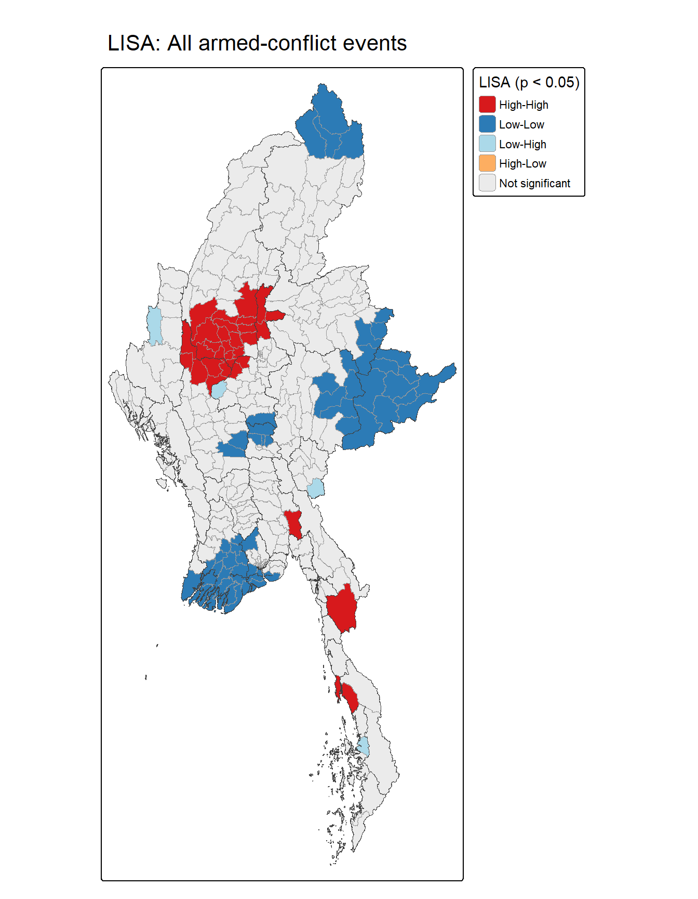
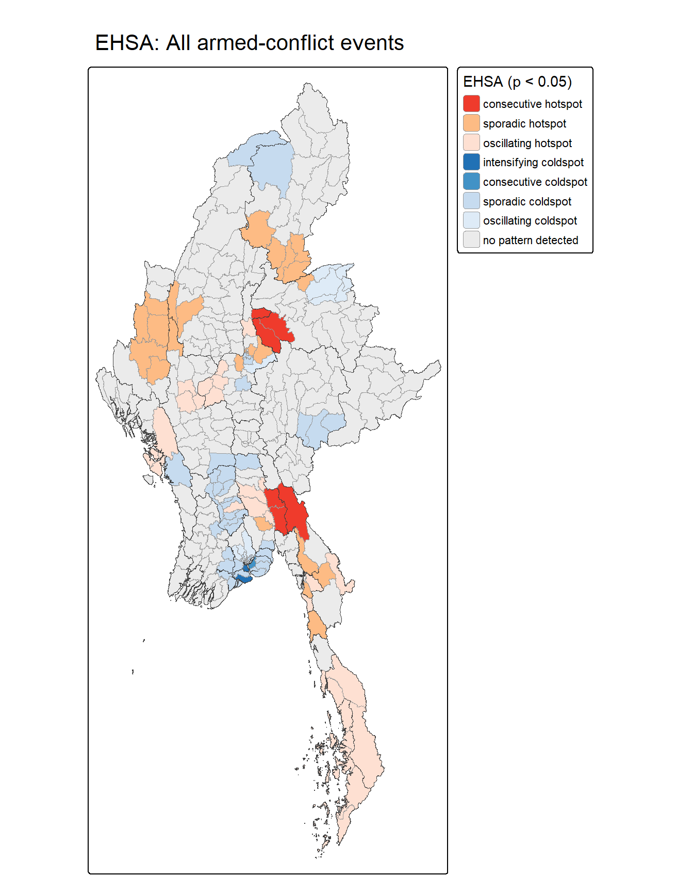

## Overview {.smaller}

### Executive Summary Structure

1. [Research Questions](#research-questions)
2. [Study Area & Data Sources](#study-area-data-sources)
3. [Analytical Approach: SPPA & Space-Time Cube](#analytical-approach-sppa-space-time-cube)
4. [Analytical Approach: LMSA & EHSA](#analytical-approach-lmsa-ehsa)
5. [Key Spatial Findings: Clustering & Hot Spots](#key-spatial-findings-clustering-hot-spots)
6. [Visual Evidence: LISA & EHSA Maps](#visual-evidence-lisa-ehsa-maps)
7. [Value-Added Analysis: Air Strike Exposure](#value-added-analysis-air-strike-exposure)
8. [Public-Safety & Humanitarian Implications](#public-safety-humanitarian-implications)
9. [Methodological Limitations](#methodological-limitations)
10. [Key References](#key-references)

---

## 1. Research Questions {#research-questions .smaller}

### Core Objectives & Questions
- **RQ1 & RQ2 (LMSA):** Where are the statistically significant clusters (High-High, Low-Low) and spatial outliers of armed conflict across Myanmar townships, and do they vary by conflict type (Battles, Remote Violence, Violence against Civilians)?
- **RQ3 (EHSA):** Where, how consistently, and in what temporal pattern have conflict hot and cold spots evolved between Q1 2021 and Q3 2025?
- **RQ4 (Value-Added):** Where are civilians most exposed to military air strikes post-Operation 1027, is this exposure tied directly to front-line ground clashes, and where are safer zones?

---

## 2. Study Area & Data Sources {#study-area-data-sources .smaller}

::: panel-tabset
### Spatial Scope & Corrections
- **Study Boundary:** Myanmar (330 Townships across 18 States and Regions; projected to WGS 84 / UTM Zone 47N).
- **Geometric Adjustments:** Corrected 41 multi-part townships (906 total pieces) and resolved out-of-boundary geometric centroids by deploying anchor points via `st_point_on_surface()` on the largest land parts.

### Data Inputs
- **Conflict Events:** ACLED Myanmar Database (1 Jan 2021 – 30 Sep 2025). Filtered out events with `geo_precision = 3` and non-conflict records, retaining **53,907 armed-conflict events**.
- **Spatial Weights:** Configured $k = 8$ Nearest Neighbours ($KNN$) using anchor points to handle massive rural-urban size disparities.
:::

---

## 3. Analytical Approach: SPPA & Space-Time Cube {#analytical-approach-sppa-space-time-cube .smaller}

::: panel-tabset
### Exploratory & Spatial Structure
- Evaluated global distributions, proving strong right-skewness where conflict concentrates heavily in the central dry zone and border peripheries.
- Addressed extreme township size variations by applying row-standardised $KNN$ weights ($k=8$).

### Space-Time Cube Construction
- Aggregated temporal bins into **19 quarters** (`qtr`) spanning Jan 2021 to Sep 2025.
- Zero-filled missing township-quarter records to establish a complete space-time panel matrix ($330 \times 19 = 6,270$ rows).
:::

---

## 4. Analytical Approach: LMSA & EHSA {#analytical-approach-lmsa-ehsa .smaller}

::: panel-tabset
### Local Measures of Spatial Association (LMSA)
- Computed local Moran’s I (99 simulations, $\alpha = 0.05$) to isolate High-High/Low-Low spatial clusters and boundary outliers.
- Evaluated individual event types (Battles, Remote Violence, Violence against Civilians) independently.

### Emerging Hot Spot Analysis (EHSA)
- Integrated quarterly $Gi^*$ scores with the Mann-Kendall monotonic trend test.
- Tested serial correlation using the Ljung-Box test and confirmed spatial trend robustness via the **modified Mann-Kendall test** (90% trend stability).
:::

---

## 5. Key Spatial Findings: Clustering & Hot Spots {#key-spatial-findings-clustering-hot-spots .smaller}

### Core vs. Periphery Polarization
- **LISA Clustering:** Confirms a persistent High-High conflict core across central Myanmar and south-eastern belts (104 significant townships, far exceeding random expectation).
- **EHSA Temporal Trends:** Reveals that conflict is actively expanding outward rather than contracting. New, consecutive, and oscillating hot spots concentrate at peripheral border states.
- **Escalation Trajectory:** Remote violence and air strikes exhibit the steepest upward temporal trends, with zero historical or diminishing hot spots indicating a lack of de-escalation.

---

## 6. Visual Evidence: LISA & EHSA Maps {#visual-evidence-lisa-ehsa-maps .smaller}

::: panel-tabset
### LISA High-High Cores
{fig-align="center" height="65%"}

### EHSA Peripheral Expansion
{fig-align="center" height="65%"}
:::

---

## 7. Value-Added Analysis: Air Strike Exposure {#value-added-analysis-air-strike-exposure .smaller}

::: panel-tabset
### Lethality & Air Power Shift
- Following Operation 1027 (Oct 2023), military air/drone strikes roughly tripled while ground clashes plateaued.
- State forces account for **71%** of all air strikes and **92.8%** of all civilian-targeted deaths, averaging significantly higher lethality per event ($p < 0.001$).

### Bivariate Local Moran’s I
- Linked post-Operation 1027 military air strikes to neighboring ground clashes ($k=8$ spatial lag).
- **Front-Line Concentration:** 23 bivariate High-High townships received **19.2%** of all air strikes. Zero High-Low clusters prove bombing tightly mirrors active ground fighting.
:::

---

## 8. Public-Safety & Humanitarian Implications {#public-safety-humanitarian-implications .smaller}

- **Long-Term Core Services:** Humanitarian assistance in the central High-High cluster must be structured for sustained, multi-year operations rather than temporary emergency relief.
- **Front-Line Air-Raid Protection:** Prioritize the 23 High-High exposure townships for decentralized bomb shelters, trauma care capacity, and localized civilian early-warning systems.
- **Early-Warning Monitoring:** Designate the 17 Low-High "watch zones" for immediate preparedness as conflict spill-overs threaten adjacent areas.
- **Strategic IDP Inflows:** Direct displaced populations toward the 94 Low-Low "safe-haven" townships (e.g., parts of the southern delta and eastern highlands), which recorded minimal air strike exposure ($<0.1\%$).

---

## 9. Methodological Limitations {#methodological-limitations .smaller}

### Analytical & Data Constraints
- **Reporting Bias:** ACLED relies on open-source reporting; severe internet shutdowns in Myanmar restrict data capture in remote conflict zones.
- **Under-Reported Harm:** Combatant vs. civilian casualties and indirect deaths from blockades or displacement are conservatively estimated.
- **Population Exposure:** Counts reflect absolute event volume rather than per-capita risk rates due to a lack of current post-2021 census denominators.
- **Spatial Weight Constraints:** Results remain sensitive to the $k=8$ nearest-neighbor structure, requiring careful interpretation for isolated island and coastal townships.

---

## 10. Key References {#key-references .smaller}

- **ACLED.** (2024). *Fatalities* [Methodology]. Armed Conflict Location & Event Data Project.
- **ACLED.** (2026). *Myanmar outlook: Fighting is set to intensify in the center of the country*.
- **Anselin, L.** (2020). *Local spatial autocorrelation (3): Multivariate local spatial autocorrelation* [GeoDa workbook].
- **Hamed, K. H., & Rao, A. R.** (1998). A modified Mann-Kendall trend test for autocorrelated data. *Journal of Hydrology*, 204(1–4), 182–196.
- **Kam, T. S.** (2026). *ISSS626 Geospatial Analytics and Applications: Lesson 5* [Lecture slides]. Singapore Management University.
- **Michaels, M.** (2023). *Operation 1027 reshapes Myanmar’s post-coup war*. International Institute for Strategic Studies.