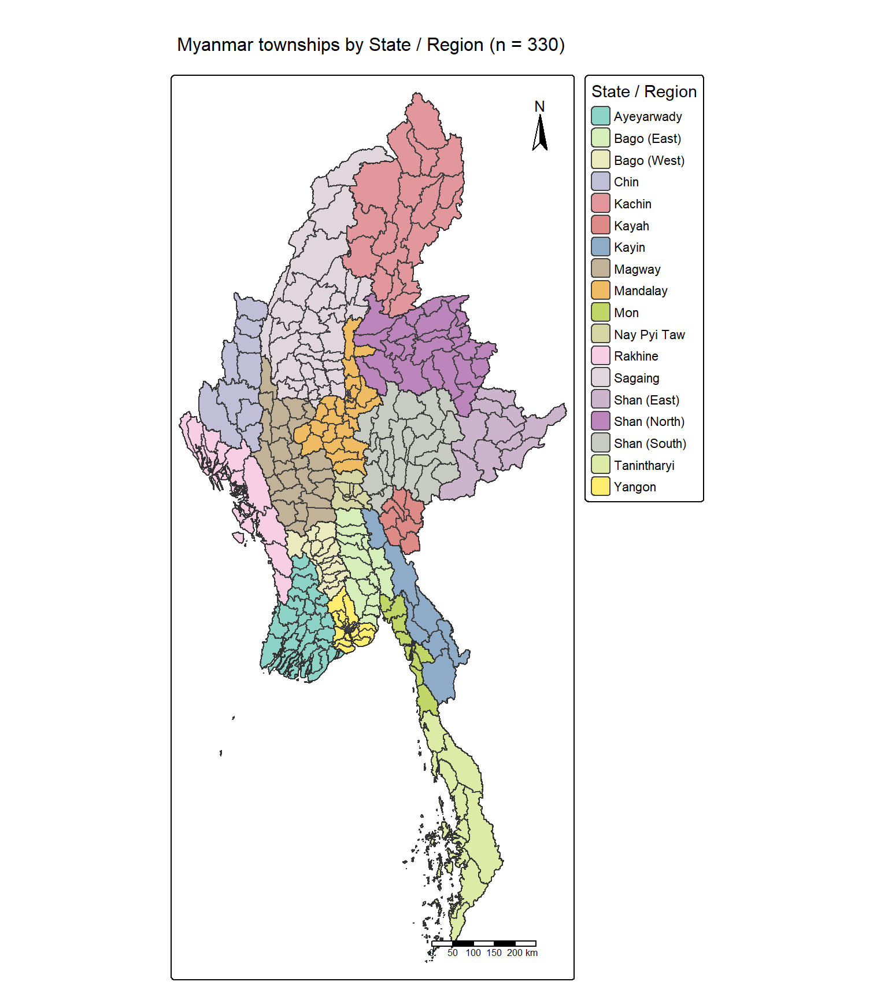
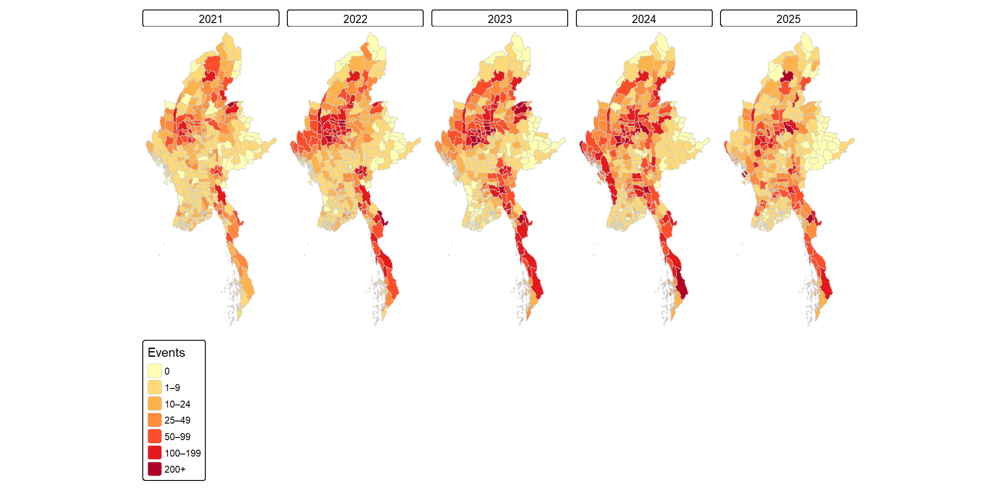
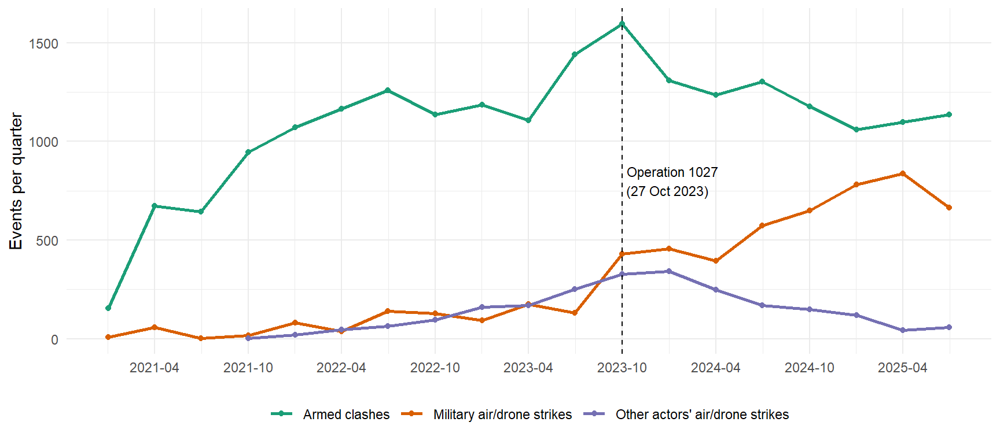
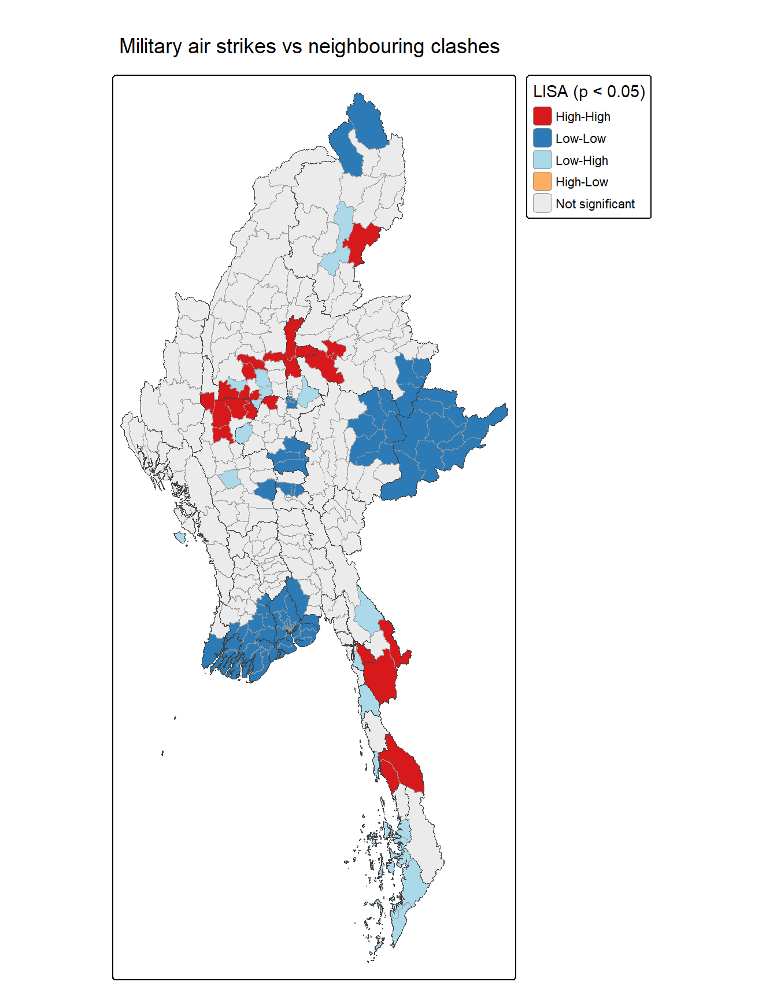

## Contents {.smaller}

1.  [Research Questions](#research-questions)
2.  [Study Area & Data](#study-area-data)
3.  [Analytical Approach](#analytical-approach)
4.  [Key Findings: Where Conflict Clusters](#findings-clusters)
5.  [Key Findings: How Conflict Is Evolving](#findings-evolving)
6.  [Value-Added: The Shift to Air Power](#air-power)
7.  [Value-Added: Is Aerial Risk Tied to Front Lines?](#front-lines)
8.  [Public-Safety Implications](#implications)
9.  [Limitations](#limitations)
10. [Key References](#key-references)

------------------------------------------------------------------------

## 1. Research Questions {#research-questions .smaller}

Since the February 2021 coup, Myanmar's conflict has become one of the world's most complex, with fragmented territorial control and mass civilian displacement. Peace-building and humanitarian actors need to know **where conflict clusters, how it is evolving, and where civilians are most at risk**.

- **RQ1:** Where are the statistically significant clusters of armed conflict, and do they differ by type (battles, explosions/remote violence, violence against civilians)?
- **RQ2:** Which townships are spatial outliers, e.g., a violent township surrounded by calm ones?
- **RQ3:** Where, how fast and in what pattern have hot and cold spots of armed conflict evolved between Q1 2021 and Q3 2025?
- **RQ4:** Where are civilians most exposed to military air strikes, is that exposure tied to front lines, and where are the relatively safer areas?

------------------------------------------------------------------------

## 2. Study Area & Data {#study-area-data .smaller}

::::: columns
::: {.column width="50%"}
**Study area**

- Myanmar's **330 townships** across 18 states/regions (MIMU v9.4), projected to WGS 84 / UTM zone 47N.
- Multi-part townships merged into one row each; 8 townships with centroids outside their boundary are represented by an **anchor point** on their largest land part.

**Data**

- **ACLED Myanmar**, 1 Jan 2021 – 30 Sep 2025 (87,109 events).
- Retained the three armed-conflict event types (battles, explosions/remote violence, violence against civilians), excluding events located only to the state/region.
- **53,907 events** assigned to townships and counted per **quarter** (330 × 19 = 6,270 township-quarters).
:::

::: {.column width="50%"}
{fig-align="center" width="90%"}
:::
:::::

------------------------------------------------------------------------

## 3. Analytical Approach {#analytical-approach .smaller}

::: panel-tabset
### Workflow

**Event data**

```{mermaid}
%%| echo: false
%%| fig-width: 12
%%{init: {"theme": "neutral", "themeVariables": {"fontSize": "20px"}, "flowchart": {"nodeSpacing": 15, "rankSpacing": 20}}}%%
flowchart LR
  A1["ACLED Myanmar<br/>2021–2025<br/>87,109 events"] --> A2["Keep 3<br/>armed-conflict<br/>types"]
  A2 --> A3["Drop<br/>geo_precision 3"]
  A3 --> A4["Assign to<br/>townships<br/>(st_join)"]
  A4 --> A5["Remove<br/>duplicates<br/>53,907 events"]
  A5 --> A6["Space-time cube<br/>330 × 19 =<br/>6,270 rows"]
  classDef data fill:#dbe9f6,stroke:#2c7bb6,color:#000
  classDef out fill:#fde0c5,stroke:#e66101,color:#000
  class A1,A2,A3,A4,A5 data
  class A6 out
```

**Spatial weights**

```{mermaid}
%%| echo: false
%%| fig-width: 12
%%{init: {"theme": "neutral", "themeVariables": {"fontSize": "20px"}, "flowchart": {"nodeSpacing": 15, "rankSpacing": 20}}}%%
flowchart LR
  W1["Township<br/>boundaries<br/>EPSG:32647"] --> W2["Anchor point<br/>on largest<br/>land part"]
  W2 --> W3["k = 8<br/>nearest<br/>neighbours"]
  W3 --> W4["Row-<br/>standardised<br/>(1/8 each)"]
  W4 --> W5["+ self for<br/>Gi* / EHSA"]
  classDef weights fill:#e3f1df,stroke:#4d9221,color:#000
  classDef out fill:#fde0c5,stroke:#e66101,color:#000
  class W1,W2,W3,W4 weights
  class W5 out
```

### Methods

| Method | Purpose |
|---|---|
| **Local Moran's I (LISA)** | Clusters (High-High, Low-Low) and outliers (High-Low, Low-High) of each conflict type |
| **Emerging Hot Spot Analysis (EHSA)** | Quarterly Gi\* with the Mann-Kendall trend test: how hot and cold spots emerge, persist or fade |
| **Ljung-Box & modified Mann-Kendall** | Checks that trends hold despite serial correlation between quarters |
| **Bivariate Local Moran's I** | Whether military air strikes in a township relate to armed clashes in neighbouring townships |

All analyses use **k = 8 nearest neighbours** with row-standardised weights, suited to Myanmar's widely varying township sizes and skewed counts, at α = 0.05.
:::

------------------------------------------------------------------------

## 4. Key Findings: Where Conflict Clusters {#findings-clusters .smaller}

::::: columns
::: {.column width="45%"}
- Armed conflict is **highly concentrated**: 104 of 330 townships are significant, far more than the \~16 expected by chance.
- A **High-High core** spans the central zone for all three conflict types, with a second cluster in the south-east.
- **Low-Low clusters** in the southern delta and eastern highlands have remained relatively insulated.
- **Low-High outliers** sit on the edges of conflict zones, the townships most at risk of spill-over. High-Low outliers are rare: high conflict is almost never isolated.
- Battles extend furthest, to the far north and border areas; violence against civilians concentrates in the centre and along the south-eastern coast.
:::

::: {.column width="55%"}
{fig-align="center" width="95%"}
:::
:::::

------------------------------------------------------------------------

## 5. Key Findings: How Conflict Is Evolving {#findings-evolving .smaller}

:::::: panel-tabset
### Emerging hot spots

::::: columns
::: {.column width="45%"}
- Conflict is **spreading outwards, not receding**. Consecutive (6) and oscillating (28) hot spots appear at the periphery: the north-central area, the south-eastern interior and the south-eastern coastal strip.
- **Pace of change:** new and consecutive hot spots mark areas where conflict has emerged recently and quickly.
- Remote violence shows the strongest escalation, with the only **intensifying** and **new** hot spots.
- **No diminishing or historical hot spots** in any run, so there is no statistical evidence of de-escalation anywhere.
- Trends are robust: 90% remain significant after correcting for serial correlation.
:::

::: {.column width="55%"}
{fig-align="center" width="95%"}
:::
:::::

### Year by year

{fig-align="center" width="100%"}
::::::

------------------------------------------------------------------------

## 6. Value-Added: The Shift to Air Power {#air-power .smaller}

{fig-align="center" width="85%"}

- After **Operation 1027** (Oct 2023), military air strikes roughly tripled and kept rising, from about one-tenth of armed clashes in 2022 to about three-quarters by 2025.
- State forces carried out **71%** of air strikes, **37.8%** of them civilian-targeted (under 6% for other groups), and account for **92.8%** of deaths from civilian-targeted air strikes.
- When civilians are targeted, military air strikes kill **1.64 people per event**, against 0.85 for all other attacks on civilians (Wilcoxon test, p \< 0.001).

------------------------------------------------------------------------

## 7. Value-Added: Is Aerial Risk Tied to Front Lines? {#front-lines .smaller}

::::: columns
::: {.column width="45%"}
Bivariate Local Moran's I of military air strikes against neighbouring armed clashes, after Operation 1027:

| Class | Townships | Meaning |
|------------------------|------------------------|------------------------|
| High-High | 23 | Heavily bombed, next to heavy fighting (19.2% of strikes) |
| High-Low | 0 | Heavy bombing away from fighting |
| Low-High | 17 | Next to heavy fighting, not yet heavily bombed |
| Low-Low | 94 | Little bombing or fighting (4 strikes in total) |

**No High-Low clusters:** bombing concentrates near active fighting rather than in quiet rear areas, so proximity to fighting is the practical warning sign for civilians.
:::

::: {.column width="55%"}
{fig-align="center" width="95%"}
:::
:::::

------------------------------------------------------------------------

## 8. Public-Safety Implications {#implications .smaller}

| Priority | Where | Action |
|------------------------|------------------------|------------------------|
| **Sustained presence** | Central High-High core | Plan humanitarian corridors, protection monitoring and services for the long term rather than as emergency relief |
| **Air-raid protection** | 23 bivariate High-High townships | Air-raid shelters, trauma care and advocacy against strikes on civilians |
| **Protection beyond clusters** | Heavily bombed townships outside High-High (\~81% of strikes) | Use strike counts alongside the clusters when targeting protection |
| **Early warning** | 17 bivariate Low-High townships and LISA Low-High outliers | Monitoring and preparedness, as conflict and aerial risk spread to neighbours of active fighting |
| **Displacement planning** | 94 relatively safer (Low-Low) townships | Plan services for likely population inflows |
| **Peace efforts** | Areas of active conflict | No area has yet de-escalated, so ceasefire efforts would have to begin where fighting is ongoing |

------------------------------------------------------------------------

## 9. Limitations {#limitations .smaller}

- **Reporting bias:** ACLED relies on media and partner reports; remote areas and internet shutdowns mean some calm areas may reflect weaker reporting.
- **Under-reported civilian harm:** ACLED does not separate civilian from combatant deaths, so civilian harm from air strikes is likely under-counted.
- **Counts, not rates:** without reliable post-2021 population figures, larger townships may appear more affected partly because of their size.
- **Scale and weights:** results depend on the choice of townships, quarters and the k = 8 neighbour definition; remote island townships should be read with caution.
- **What EHSA can show:** maps are filtered on the trend test, so persistent hot spots with no trend rarely appear.
- **Clusters, not volume:** the bivariate test flags where bombing and nearby fighting occur together, not where bombing is heaviest.
- **"Relatively safer" is not "safe":** Low-Low townships have few strikes *relative to others*, and ACLED cannot confirm where displaced people actually move.

------------------------------------------------------------------------

## 10. Key References {#key-references .smaller}

- ACLED. (2024). *Fatalities* \[Methodology, last updated 7 May 2024\]. Armed Conflict Location & Event Data Project. https://acleddata.com/methodology/fatalities
- ACLED. (2026, July 27). *Myanmar outlook: Fighting is set to intensify in the center of the country*. Armed Conflict Location & Event Data Project. https://acleddata.com/report/myanmar-outlook-fighting-set-intensify-center-country
- Anselin, L. (2020). *Local spatial autocorrelation (3): Multivariate local spatial autocorrelation* \[GeoDa workbook\]. https://geodacenter.github.io/workbook/6c_local_multi/lab6c.html
- ESRI. (n.d.). *Modeling spatial relationships*. ArcGIS Pro documentation. https://pro.arcgis.com/en/pro-app/3.4/tool-reference/spatial-statistics/modeling-spatial-relationships.htm
- Hamed, K. H., & Rao, A. R. (1998). A modified Mann-Kendall trend test for autocorrelated data. *Journal of Hydrology, 204*(1–4), 182–196. https://doi.org/10.1016/S0022-1694(97)00125-X
- Hyndman, R. J., & Athanasopoulos, G. (2021). *Forecasting: Principles and practice* (3rd ed.). OTexts. https://otexts.com/fpp3/diagnostics.html
- Kam, T. S. (2026). *ISSS626 Geospatial Analytics and Applications: Lesson 5, Global and local measures of spatial association* \[Lecture slides\]. Singapore Management University.
- Kam, T. S., & Zhi, V. (2018). Is there space for violence?: A data-driven approach to the exploration of spatial-temporal dimensions of conflict. In *Proceedings of the 2nd ACM SIGSPATIAL Workshop on Geospatial Humanities* (pp. 1–10). ACM.
- Ljung, G. M., & Box, G. E. P. (1978). On a measure of lack of fit in time series models. *Biometrika, 65*(2), 297–303. https://doi.org/10.1093/biomet/65.2.297
- Lovelace, R., Nowosad, J., & Muenchow, J. (2026). *Geocomputation with R*. https://r.geocompx.org/geometry-operations.html
- Michaels, M. (2023, November). *Operation 1027 reshapes Myanmar's post-coup war*. International Institute for Strategic Studies. https://myanmar.iiss.org/analysis/2023-11
- Patakamuri, S. K., & O'Brien, N. (2021). *modifiedmk: Modified versions of Mann Kendall and Spearman's Rho trend tests* \[R package\]. https://CRAN.R-project.org/package=modifiedmk
- Pebesma, E., & Bivand, R. (2023). *Spatial data science: With applications in R* (ch. 14, Proximity and areal data). https://r-spatial.org/book/14-Areal.html
- Voice of America. (2025, February 24). *Report: In record year of internet shutdowns, Myanmar leads*. https://www.voanews.com/a/report-in-record-year-of-internet-shutdowns-myanmar-leads/7985585.html