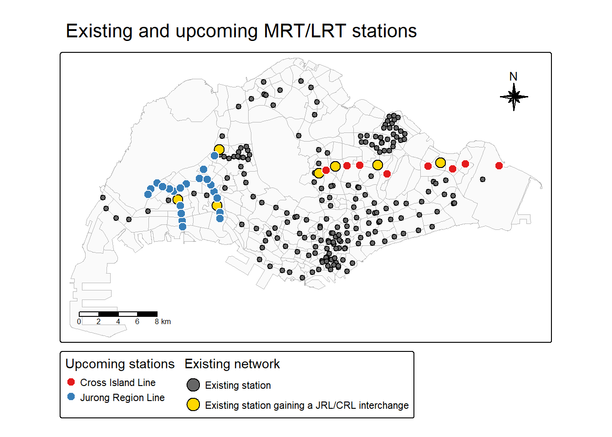
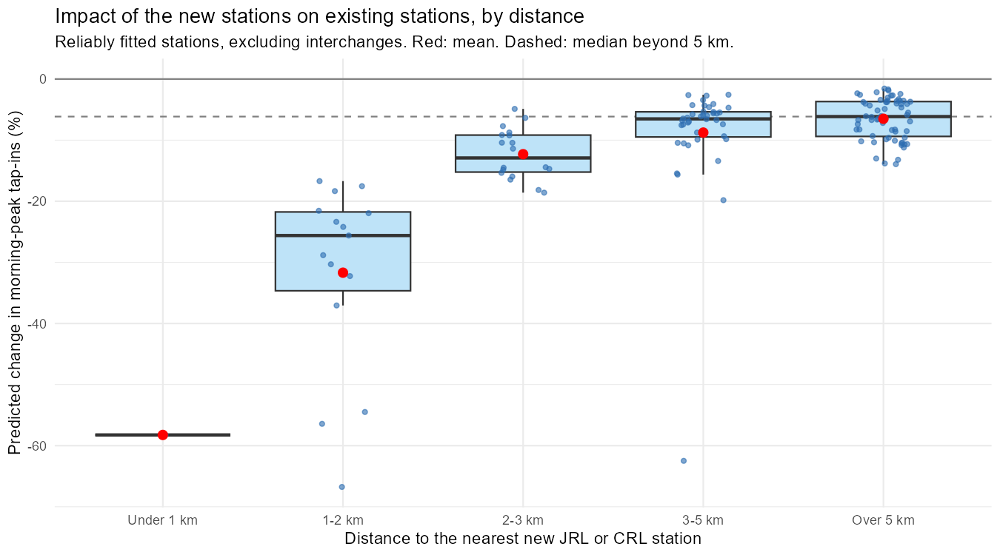
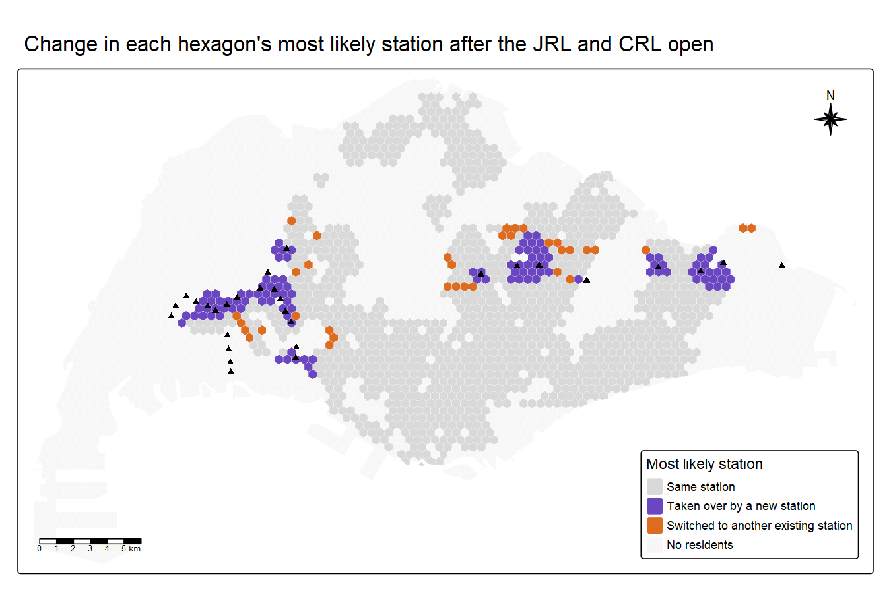
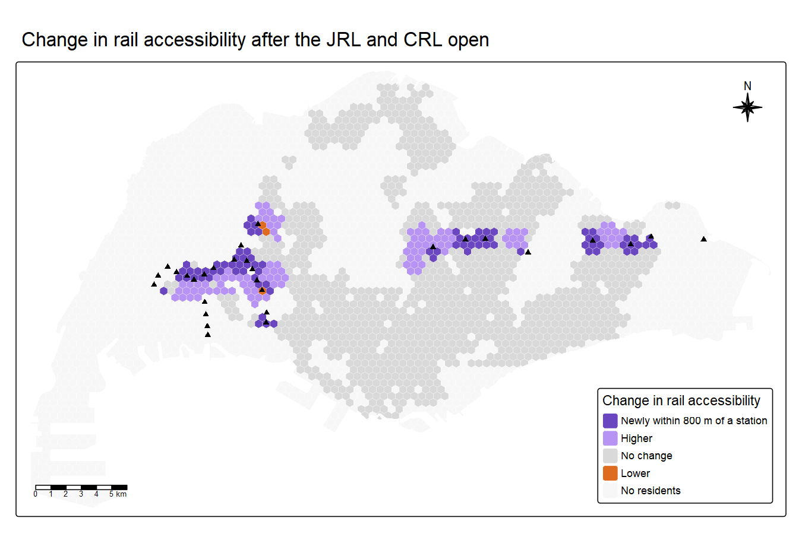
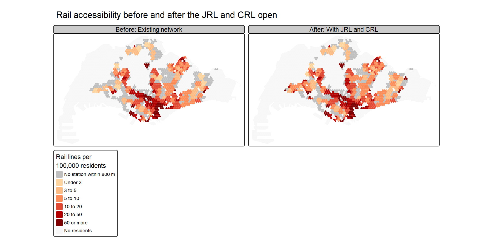

## 1. Context & Research Questions {#context .smaller}

By 2030, the **Jurong Region Line (JRL, 24 stations)** and **Cross Island Line Phase 1 (CRL, 12 stations)** will add 36 stations to Singapore's rail network. Stations built ahead of demand carry operating costs with few riders: Hume station stood unopened for a decade because projected ridership did not justify it. New stations also compete with existing ones for the same residents.

- **RQ1:** How well does a calibrated probabilistic spatial interaction model explain weekday morning-peak ridership at existing stations, and which station attributes matter beyond distance?
- **RQ2:** What ridership can be expected at the 36 JRL and CRL stations, and which are at risk of low ridership?
- **RQ3:** How will the new stations redistribute the ridership and market areas of existing stations?
- **Value-added:** Which communities gain access to rail, and does the expansion reach the areas that are least served today?

------------------------------------------------------------------------

## 2. Data & Approach {#approach .smaller}

:::::: panel-tabset
### Workflow

```{mermaid}
%%| echo: false
%%| fig-width: 12
%%{init: {"theme": "neutral", "themeVariables": {"fontSize": "20px"}, "flowchart": {"nodeSpacing": 15, "rankSpacing": 20}}}%%
flowchart LR
  P1["SingStat residents<br/>aged 15-64<br/>by subzone"] --> P2["Placed on HDB blocks<br/>and private housing<br/>land (dasymetric)"]
  P2 --> P3["500 m hexagons<br/>1,211 populated<br/>origins"]
  T1["LTA passenger volume<br/>Jul-Sep 2026"] --> T2["Weekday 7-9am<br/>tap-ins at<br/>184 stations"]
  P3 --> M["Huff / MCI model<br/>calibrated on<br/>station totals"]
  T2 --> M
  M --> O1["Predict 29 new<br/>stations (213 in total)"]
  M --> O2["Impact on existing<br/>stations and<br/>market areas"]
  M --> O3["Change in access<br/>to rail (Huff-2SFCA)"]
  classDef data fill:#dbe9f6,stroke:#2c7bb6,color:#000
  classDef model fill:#e3f1df,stroke:#4d9221,color:#000
  classDef out fill:#fde0c5,stroke:#e66101,color:#000
  class P1,P2,P3,T1,T2 data
  class M model
  class O1,O2,O3 out
```

### Data

::::: columns
::: {.column width="50%"}
- **Origins:** 2.84 million residents aged 15-64 (June 2026), spread onto HDB blocks by flats and onto private housing land by area, then summed into **1,211 populated hexagons**.
- **Destinations:** **184 existing** MRT/LRT stations, plus **29 new** stations; 7 existing stations gain a JRL or CRL line.
- **Observed ridership:** average weekday **7-9am tap-ins**, July-September 2026.
- **Attractiveness:** lines served, MRT or LRT, bus stops and bus interchanges, and nearby shops, food, schools, healthcare and community facilities within 400 m.
:::

::: {.column width="50%"}
{fig-align="center" width="95%"}
:::
:::::

### Methods

| Method | Purpose |
|------------------------------------|------------------------------------|
| **Huff / MCI model** | Probability that residents of each hexagon use each station, from distance and station attractiveness |
| **Calibration on station totals** | Distance decay and attribute exponents fitted to observed tap-ins, as origin-to-station flows are not available |
| **Holdout validation** | 12 recently opened stations predicted as if new, to test predictions before opening |
| **Before-and-after comparison** | Same model and population with the existing and future networks, so changes are due only to the new stations |
| **Huff-2SFCA** | Rail lines per resident reachable within 800 m, before and after |
::::::

------------------------------------------------------------------------

## 3. Calibrating the Model {#model .smaller}

:::::: panel-tabset
### Model comparison

{fig-align="center" width="90%"}

| Model | Distance decay λ | Pseudo-R² | Median error |
|---------------------|---------------|---------------|---------------|
| M0: distance only, λ = −2 | −2.00 | 0.53 | 61% |
| M1: calibrated distance decay | −2.77 | 0.58 | 54% |
| **M2: MCI with station attributes** | **−2.52** | **0.83** | **30%** |

### What attracts residents

::::: columns
::: {.column width="50%"}
| Attribute | Exponent | Effect |
|------------------|------------------|------------------|
| Number of lines | 1.16 | Two-line interchange ≈ 2.2× as attractive |
| MRT (vs LRT) | 0.72 | LRT ≈ 4% as attractive as MRT |
| Bus stops within 400 m | 0.41 | Feeder buses extend the catchment |
| Shopping / food | 0.31 / −0.16 | Read together; strongly correlated |
| Bus interchange, schools, healthcare, community | — | Not significant |
:::

::: {.column width="50%"}
- Residents keep strongly to their **nearest station** (λ = −2.52, 95% CI −2.74 to −2.29).
- Beyond distance, residents choose a station for **how well it connects them onward**, not for what lies around it.
- Largest errors: stations used mainly by **non-residents** (Tuas, Kranji) and **destination** stations (Expo, Keppel).
:::
:::::

### Holdout test

- 12 stations that opened between 2024 and 2026 (TEL Stage 4, Punggol Coast, Hume, CCL Stage 6) were predicted **as if they had not opened**.
- The **ranking** is right: Spearman correlation of **0.89** between predicted and observed tap-ins.
- But **all 12 are over-predicted**, by a median of **1.7×**: residents keep their old station and bus route for some time after a new one opens.
- Predictions are therefore ridership **after habits adjust**. In the opening years, ridership could be around **40% lower**.
::::::

------------------------------------------------------------------------

## 4. Ridership at the New Stations {#new-stations .smaller}

::::: columns
::: {.column width="55%"}
{fig-align="center" width="95%"}
:::

::: {.column width="45%"}
- The 29 new stations are predicted to carry about **69,000** morning tap-ins a day, **12.1%** of the network.
- **Busiest:** Serangoon North (≈7,000), Pasir Ris East (≈6,400) and Choa Chu Kang West (≈6,100), all in established housing areas.
- **9 stations** fall below the benchmark of **844 tap-ins**, almost exactly Hume's ridership: Aviation Park, Jurong Pier, Peng Kang Hill, Jurong Hill, Nanyang Gateway, Nanyang Crescent, Tawas, Tukang and Tengah.
- Most serve **industrial estates, NTU or the airport area**, where riders are workers and students who are not in the resident data. **Six have no residents within 800 m.**
- The list barely changes when distance decay is varied (rank correlation ≥ 0.98).
:::
:::::

------------------------------------------------------------------------

## 5. Impact on Existing Stations {#impact .smaller}

:::::: panel-tabset
### Map

::::: columns
::: {.column width="55%"}
{fig-align="center" width="95%"}
:::

::: {.column width="45%"}
- Largest losses on the **East-West Line in Jurong**: Chinese Garden (−58%), Lakeside (−56%) and Pioneer (−55%), whose residents gain a JRL station closer to home.
- On the CRL, losses at **Kovan, Tampines East, Mayflower and Upper Thomson** (−23% to −29%).
- Joo Koon and Gul Circle show the largest losses, but their riders are mostly workers the model does not represent.
:::
:::::

### Interchanges

| Interchange | New line | Tap-ins now | Expected after | Change |
|------------------|------------------|------------------|------------------|------------------|
| Bright Hill | CRL | 1,701 | 2,358 | **+39%** |
| Hougang | CRL | 9,239 | 12,176 | **+32%** |
| Ang Mo Kio | CRL | 10,164 | 11,635 | **+14%** |
| Pasir Ris | CRL | 10,309 | 10,522 | +2% |
| Choa Chu Kang | JRL | 9,717 | 8,049 | −17% |
| Jurong East | JRL | 6,201 | 4,132 | −33% |
| Boon Lay | JRL | 10,752 | 6,860 | −36% |

**CRL interchanges gain** riders from the extra line. **JRL interchanges lose tap-ins** because their riders can board closer to home, but they will carry new **transfer traffic**, which tap-ins do not measure.

### By distance

::::: columns
::: {.column width="55%"}
{fig-align="center" width="95%"}
:::

::: {.column width="45%"}
| Distance to new station | Median change |
|------------------|------------------|
| 1-2 km | −25.6% |
| 2-3 km | −12.9% |
| 3-5 km | −6.5% |
| Over 5 km | −6.1% |

The **−6% background** beyond 5 km is a property of the model: a new station draws proportionally from every station. Only losses well beyond it reflect real competition.
:::
:::::
::::::

------------------------------------------------------------------------

## 6. Shifting Market Areas {#market-areas .smaller}

:::::: panel-tabset
### Share to new stations

::::: columns
::: {.column width="55%"}
{fig-align="center" width="95%"}
:::

::: {.column width="45%"}
- **87 hexagons** are predicted to send more than half of their morning trips to a new station, and **162** more than a quarter.
- They are concentrated in **Tengah and Jurong West** on the JRL, and around **Serangoon North, Tavistock, Tampines North and Pasir Ris East** on the CRL.
- Away from the new lines, the share is under 5%.
:::
:::::

### Most likely station

::::: columns
::: {.column width="55%"}
{fig-align="center" width="95%"}
:::

::: {.column width="45%"}
- **112 hexagons** are taken over by a new station.
- **35** switch to another existing station, and **every one** switches to one of the seven interchanges gaining a line. An extra line extends an interchange's market area into its neighbours'.
- Where a new station takes most trips, residents gain a clear nearest station. Where it takes a partial share, residents become more evenly split between stations.
:::
:::::
::::::

------------------------------------------------------------------------

## 7. Value-Added: Access to Rail {#access .smaller}

:::::: panel-tabset
### Change in access

::::: columns
::: {.column width="55%"}
{fig-align="center" width="95%"}
:::

::: {.column width="45%"}
- Residents within **800 m** of a station: **71.6% → 79.7%**, about **229,000** more people.
- **80 hexagons** gain a station within 800 m for the first time.
- Areas away from the new lines are unchanged. Unlike the ridership model, this measure has **no background effect**.
- Related target: 8 in 10 households within a 10-minute walk of a station by the 2030s (Ministry of Transport, 2024).
:::
:::::

### Before and after

{fig-align="center" width="100%"}

### Planning areas

| Planning area | Within 800 m before | Within 800 m after | Change in access |
|------------------|------------------|------------------|------------------|
| Jurong East | 50% | 90% | **+9.6** |
| Tengah | 0% | 84% | **+8.3** |
| Jurong West | 53% | 81% | +5.0 |
| Pasir Ris | 35% | 63% | +3.1 |
| Ang Mo Kio | 76% | 86% | +2.5 |

Access in rail lines per 100,000 residents aged 15-64. The **same five planning areas** gain most with a 1 km catchment, in the same order.
::::::

------------------------------------------------------------------------

## 8. Implications & Recommendations {#implications .smaller}

| Priority | Where | Action |
|------------------------|------------------------|------------------------|
| **Verify low demand before deciding** | 9 low-ridership stations (Aviation Park, Jurong Pier, Jurong Hill, Nanyang Gateway, Nanyang Crescent, Peng Kang Hill, Tawas, Tukang, Tengah) | Estimate worker, student and dormitory demand, which this model omits, before decisions on opening dates or service levels |
| **Plan for ramp-up** | All new stations | Expect ridership well below predictions in the first months; phase in service levels as ridership builds up |
| **Feeder bus review** | Jurong East-West Line stations (Chinese Garden, Lakeside, Pioneer) and Bukit Batok | Adjust feeder services as residents switch to JRL stations nearer home |
| **Interchange capacity** | Bright Hill, Hougang, Ang Mo Kio (tap-in growth); Boon Lay, Jurong East, Choa Chu Kang (transfers) | Size platforms and concourses for both tap-ins and transfer flows |
| **Prioritise the least served** | Tengah, Jurong West, Pasir Ris | Rail access improves most here; align walking and cycling links to the new stations so residents can reach them |

------------------------------------------------------------------------

## 9. Limitations & Key References {#limitations .smaller}

::::: panel-tabset
### Limitations

- **Residents only:** foreign workers, students in hostels and cross-border commuters are not in the SingStat data, so industrial and campus stations are likely under-predicted.
- **Morning tap-ins only:** transfers between lines and a station's role as a destination are not measured.
- **Population fixed at June 2026:** future housing in Tengah and Jurong Lake District is not included, so predictions there are conservative.
- **Calibrated on station totals:** 184 stations for 10 parameters, with straight-line distances and no walking network or feeder buses.
- **Immediate switching assumed:** the holdout test shows real ridership builds up gradually.
- **Background loss:** the model spreads a new station's riders across every station, so small losses far from the new lines are not real.

### Key References

- De Beule, M., Van den Poel, D., & Van de Weghe, N. (2014). An extended Huff-model for robustly benchmarking and predicting retail network performance. *Applied Geography, 46*, 80-89. https://doi.org/10.1016/j.apgeog.2013.09.026
- Huff, D. L. (1964). Defining and estimating a trading area. *Journal of Marketing, 28*(3), 34-38. https://doi.org/10.2307/1249154
- Kam, T. S. (2026). *R for geospatial data science and analytics*. https://r4gdsa.netlify.app/
- Luo, J. (2014). Integrating the Huff model and floating catchment area methods to analyze spatial access to healthcare services. *Transactions in GIS, 18*(3), 436-448. https://doi.org/10.1111/tgis.12096
- Ministry of Transport. (2024, October 15). *Response by Senior Minister of State for Transport Dr Amy Khor to adjournment motion on realising the vision of a 45-minute city under the Land Transport Master Plan 2040 in the West of Singapore* [Speech].
- Nakanishi, M., & Cooper, L. G. (1974). Parameter estimation for a multiplicative competitive interaction model: Least squares approach. *Journal of Marketing Research, 11*(3), 303-311. https://doi.org/10.2307/3151146
- Olszewski, P., & Wibowo, S. S. (2005). Using equivalent walking distance to assess pedestrian accessibility to transit stations in Singapore. *Transportation Research Record, 1927*(1), 38-45. https://doi.org/10.1177/0361198105192700105
- Orpana, T., & Lampinen, J. (2003). Building spatial choice models from aggregate data. *Journal of Regional Science, 43*(2), 319-348. https://doi.org/10.1111/1467-9787.00301
- Wieland, T. (2017). Market area analysis for retail and service locations with MCI. *The R Journal, 9*(1), 298-323. https://doi.org/10.32614/RJ-2017-020
- Zhu, Z., He, Y., Guo, X., Zhang, Y., & Chen, J. (2021). Improved Huff model for estimating urban rail transit station catchment areas considering station choices. *Journal of Advanced Transportation, 2021*, Article 6374724. https://doi.org/10.1155/2021/6374724

:::::