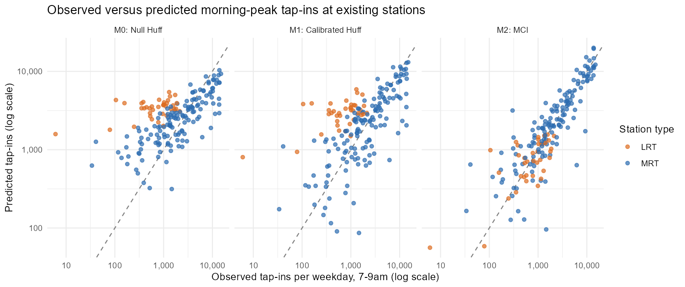
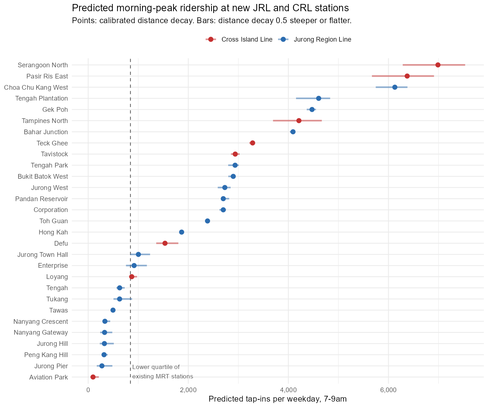
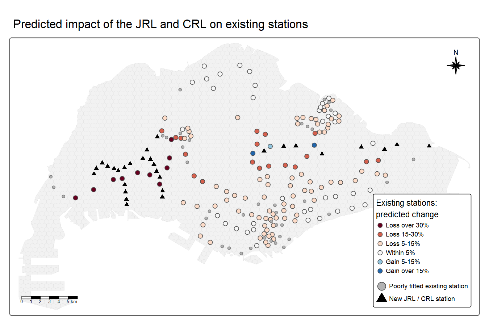
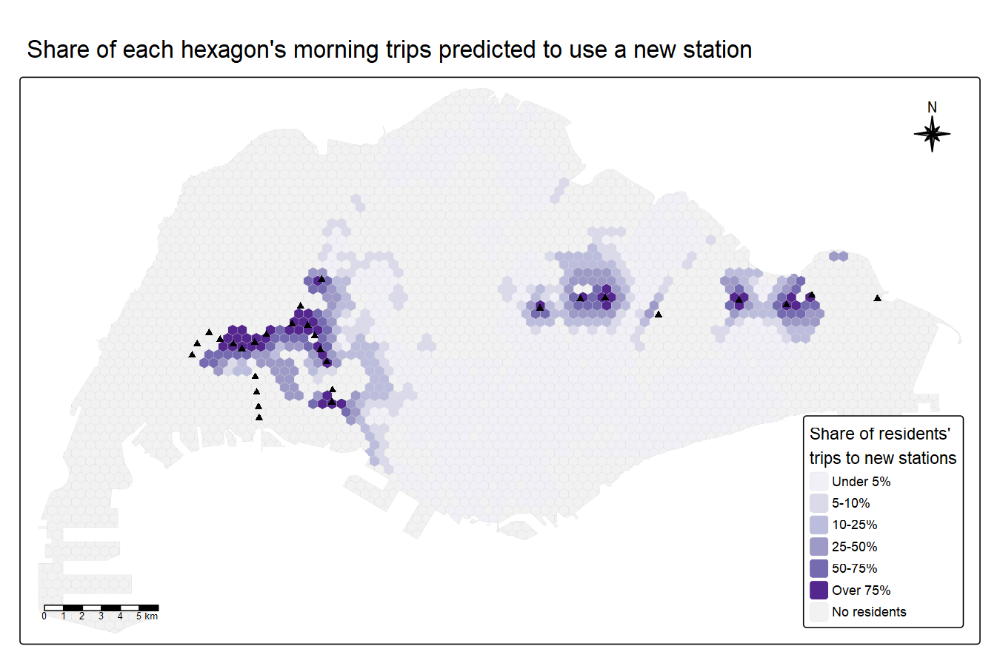
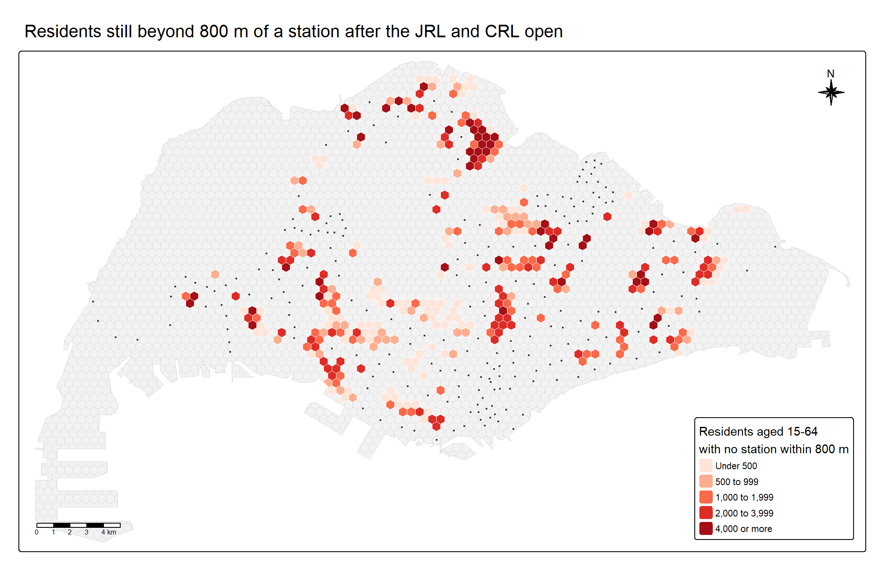

## Contents {.smaller}

1.  [Context & Research Questions](#context)
2.  [Study Area & Data](#data)
3.  [Analytical Approach](#approach)
4.  [Calibrating the Model](#model)
5.  [Ridership at the New Stations](#new-stations)
6.  [Impact on Existing Stations & Market Areas](#impact)
7.  [Value-Added: Who Gains Access to Rail](#access)
8.  [Value-Added: Where Gaps Remain](#gaps)
9.  [Implications & Recommendations](#implications)
10. [Limitations & Key References](#limitations)

------------------------------------------------------------------------

## 1. Context & Research Questions {#context .smaller}

By 2030, the **Jurong Region Line (JRL, 24 stations)** and **Cross Island Line Phase 1 (CRL, 12 stations)** will add 36 stations to Singapore's rail network. Stations built ahead of demand carry operating costs with few riders: Hume station stood unopened for a decade because projected ridership did not justify it. New stations also compete with existing ones, and the government aims for **8 in 10 households to be within a 10-minute walk of a train station by the 2030s**.

- **RQ1:** How well does a calibrated probabilistic spatial interaction model explain weekday morning-peak ridership at existing stations, and which station attributes matter beyond distance?
- **RQ2:** What ridership can be expected at the JRL and CRL Phase 1 stations, and which are at risk of low ridership?
- **RQ3:** How will the new stations redistribute the ridership and market areas of existing stations?
- **RQ4 (value-added):** How will the new lines change residents' access to stations within walking distance, where will residents remain beyond walking distance, and do the new stations open ahead of the populations they serve?

------------------------------------------------------------------------

## 2. Study Area & Data {#data .smaller}

::::: columns
::: {.column width="50%"}
**Study area**

- **Mainland Singapore**: offshore islands excluded, as they have no HDB flats and no MRT/LRT stations.
- **500 m hexagons** as origins: **1,211 populated hexagons** of 3,318.

**Data**

- **Residents aged 15–64** (SingStat, June 2026): about 2.84 million, placed on HDB blocks by flats and on private housing land by area. No values imputed; subzone totals kept exactly.
- **Ridership:** average weekday **7–9am tap-ins**, July–September 2026 (LTA DataMall).
- **Stations:** **184 existing**, **29 new**; 7 existing stations gain a JRL or CRL line.
- **Attractiveness:** lines, MRT or LRT, bus stops and interchanges, and shops, food, schools, healthcare and community facilities within 400 m (LTA, OpenStreetMap).
:::

::: {.column width="50%"}
{fig-align="center" width="95%"}
:::
:::::

------------------------------------------------------------------------

## 3. Analytical Approach {#approach .smaller}

::: panel-tabset
### Workflow

```{mermaid}
%%| echo: false
%%| fig-width: 12
%%{init: {"theme": "neutral", "themeVariables": {"fontSize": "20px"}, "flowchart": {"nodeSpacing": 15, "rankSpacing": 20}}}%%
flowchart LR
  P1["SingStat residents<br/>aged 15–64<br/>by subzone"] --> P2["Placed on HDB blocks<br/>and private housing<br/>land (dasymetric)"]
  P2 --> P3["500 m hexagons<br/>1,211 populated<br/>origins"]
  T1["LTA passenger volume<br/>Jul–Sep 2026"] --> T2["Weekday 7–9am<br/>tap-ins at<br/>184 stations"]
  P3 --> M["Huff / MCI model<br/>calibrated on<br/>station totals"]
  T2 --> M
  M --> O1["Predict 29 new<br/>stations"]
  M --> O2["Impact on existing<br/>stations and<br/>market areas"]
  M --> O3["Huff-2SFCA access,<br/>remaining gaps,<br/>opening timing"]
  classDef data fill:#dbe9f6,stroke:#2c7bb6,color:#000
  classDef model fill:#e3f1df,stroke:#4d9221,color:#000
  classDef out fill:#fde0c5,stroke:#e66101,color:#000
  class P1,P2,P3,T1,T2 data
  class M model
  class O1,O2,O3 out
```

### Methods

| Method | Purpose |
|------------------------------------|------------------------------------|
| **Huff / MCI model** | Probability that residents of each hexagon use each station, from distance and station attractiveness |
| **Null model (M0)** | Distance alone, with the conventional decay of −2, as a reference |
| **Calibration on station totals** | Distance decay and attribute exponents fitted to observed tap-ins, as origin-to-station flows are not available |
| **Holdout validation** | 12 recently opened stations predicted as if new |
| **Before-and-after comparison** | Same model and population with the existing and future networks |
| **Huff-2SFCA (value-added)** | Rail lines per resident within 800 m, before and after; remaining gaps against the 8-in-10 target |
:::

------------------------------------------------------------------------

## 4. Calibrating the Model {#model .smaller}

:::::: panel-tabset
### Model comparison

{fig-align="center" width="90%"}

| Model | Distance decay λ | Pseudo-R² | Median error |
|---------------------|---------------|---------------|---------------|
| M0: distance only, λ = −2 | −2.00 | 0.53 | 61% |
| M1: calibrated distance decay | −2.77 | 0.58 | 54% |
| **M2: MCI with station attributes** | **−2.52** | **0.83** | **30%** |

### What attracts residents

::::: columns
::: {.column width="50%"}
| Attribute | Exponent | Effect |
|------------------|------------------|------------------|
| Number of lines | 1.16 | Two-line interchange ≈ 2.2× as attractive |
| MRT (vs LRT) | 0.72 | LRT ≈ 4% as attractive as MRT |
| Bus stops within 400 m | 0.41 | Feeder buses extend the catchment |
| Shopping / food | 0.31 / −0.16 | Read together; strongly correlated |
| Bus interchange, schools, healthcare, community | — | Not significant |
:::

::: {.column width="50%"}
- Residents keep strongly to their **nearest station** (λ = −2.52, 95% CI −2.74 to −2.29).
- Beyond distance, residents choose a station for **how well it connects them onward**.
- Largest errors: stations used by **non-residents** (Tuas, Kranji, Changi Airport) and **destination** stations (Expo, Keppel).
:::
:::::

### Holdout test

- 12 stations that opened between 2024 and 2026 (TEL Stage 4, Punggol Coast, Hume, CCL Stage 6) were predicted **as if they had not opened**.
- The **ranking** is right: Spearman correlation of **0.89** between predicted and observed tap-ins.
- But **all 12 are over-predicted**, by a median of **1.7×**: residents keep their old station and bus route for some time after a new one opens.
- Predictions are therefore ridership **after habits adjust**. In the opening years, ridership could be around **40% lower**.
::::::

------------------------------------------------------------------------

## 5. Ridership at the New Stations {#new-stations .smaller}

:::::: panel-tabset
### Predictions

::::: columns
::: {.column width="55%"}
{fig-align="center" width="95%"}
:::

::: {.column width="45%"}
- The 29 new stations are predicted to carry about **69,000** morning tap-ins a day, **12.1%** of the network.
- **Busiest:** Serangoon North (≈7,000), Pasir Ris East (≈6,400) and Choa Chu Kang West (≈6,100), all in established housing areas.
- **Nine stations** fall below the benchmark of **844 tap-ins**, almost exactly Hume's ridership.
- Most serve **industrial estates, NTU or the airport area**, where riders are workers and students not in the resident data.
- The ranking barely changes when distance decay is varied (rank correlation ≥ 0.97).
:::
:::::

### By opening stage

| Stage | Opens | New stations | Below benchmark | Median predicted |
|------------------|------------------|------------------|------------------|------------------|
| JRL Stage 1 | 2028 | 8 | 2 (Tawas, Tengah) | 2,714 |
| JRL Stage 2 | 2028 | 6 | 0 | 2,799 |
| **JRL Stage 3** | **2029** | **7** | **6** | **327** |
| CRL Phase 1 | 2030 | 8 | 1 (Aviation Park) | 3,111 |

**JRL Stage 3 opens ahead of its demand.** Six of its seven stations serve NTU and Jurong's industrial estates, and five have **no residents within 800 m**. Tengah also opens while its new town is still filling, and Aviation Park opens in 2030, before Changi Terminal 5 in the mid-2030s.
::::::

------------------------------------------------------------------------

## 6. Impact on Existing Stations & Market Areas {#impact .smaller}

:::::: panel-tabset
### Station impact

::::: columns
::: {.column width="55%"}
{fig-align="center" width="95%"}
:::

::: {.column width="45%"}
- Largest losses on the **East-West Line in Jurong**: Chinese Garden (−58%), Lakeside (−56%) and Pioneer (−55%).
- On the CRL corridor: Kovan, Tampines East, Mayflower and Upper Thomson (−23% to −29%).
- The impact **fades within about 3 km**. Beyond 5 km, a **−6% background** loss is a property of the model, not real competition.
:::
:::::

### Interchanges

| Interchange | New line | Tap-ins now | Expected after | Change |
|------------------|------------------|------------------|------------------|------------------|
| Bright Hill | CRL | 1,701 | 2,358 | **+39%** |
| Hougang | CRL | 9,239 | 12,176 | **+32%** |
| Ang Mo Kio | CRL | 10,164 | 11,635 | **+14%** |
| Pasir Ris | CRL | 10,309 | 10,522 | +2% |
| Choa Chu Kang | JRL | 9,717 | 8,049 | −17% |
| Jurong East | JRL | 6,201 | 4,132 | −33% |
| Boon Lay | JRL | 10,752 | 6,860 | −36% |

**CRL interchanges gain** riders from the extra line. **JRL interchanges lose tap-ins** but will carry new **transfer traffic**, which tap-ins do not measure.

### Market areas

::::: columns
::: {.column width="55%"}
{fig-align="center" width="95%"}
:::

::: {.column width="45%"}
- **87 hexagons** are predicted to send more than half of their morning trips to a new station, and **162** more than a quarter.
- **147 hexagons** change their most likely station: **112** to a new station, and **35** to one of the seven interchanges gaining a line.
- Concentrated in **Tengah and Jurong West** on the JRL, and around **Serangoon North, Tavistock, Tampines North and Pasir Ris East** on the CRL.
:::
:::::
::::::

------------------------------------------------------------------------

## 7. Value-Added: Who Gains Access to Rail {#access .smaller}

:::::: panel-tabset
### Change in access

::::: columns
::: {.column width="55%"}
{fig-align="center" width="95%"}
:::

::: {.column width="45%"}
- **Huff-2SFCA:** rail lines per resident within **800 m**, sharing each resident's demand among reachable stations using the calibrated Huff probabilities.
- Residents within 800 m of a station: **71.6% → 79.7%**, about **229,000** more people.
- **80 hexagons** gain a station within 800 m for the first time.
- Areas away from the new lines are unchanged: unlike the ridership model, this measure has **no background effect**.
:::
:::::

### Planning areas

| Planning area | Within 800 m before | Within 800 m after | Change in access |
|------------------|------------------|------------------|------------------|
| Jurong East | 50% | 90% | **+9.6** |
| Tengah | 0% | 84% | **+8.3** |
| Jurong West | 53% | 81% | +5.0 |
| Pasir Ris | 35% | 63% | +3.1 |
| Ang Mo Kio | 76% | 86% | +2.5 |

Access in rail lines per 100,000 residents aged 15–64. With a **1 km** catchment, the same five areas gain most, **in the same order**.
::::::

------------------------------------------------------------------------

## 8. Value-Added: Where Gaps Remain {#gaps .smaller}

::::: columns
::: {.column width="55%"}
{fig-align="center" width="95%"}
:::

::: {.column width="45%"}
- **79.7%** of residents are within 800 m *in a straight line*. Walking distances are longer, so the network reaches the **8-in-10 target** rather than clearly passing it.
- **576,000 residents** remain beyond 800 m, in three groups:

| Group | Where | Residents beyond 800 m |
|------------------|------------------|------------------|
| **Dense HDB towns, no new line** | Yishun (62% of residents), Hougang, Woodlands, Tampines | **423,800 (74%)** |
| **Reached by 2032** | Clementi, Pasir Ris, Bukit Timah, Punggol (CRL Phase 2, Punggol Extension) | 94,100 |
| **Low-density private estates** | Serangoon, Ang Mo Kio, Queenstown | Few per hexagon |
:::
:::::

------------------------------------------------------------------------

## 9. Implications & Recommendations {#implications .smaller}

| Priority | Where | Action |
|------------------------|------------------------|------------------------|
| **1. Close the largest remaining gaps** | Yishun, Hougang, Woodlands, Tampines: dense HDB towns that no new line reaches | Covered linkways to 800 m and direct feeder buses now; candidates for infill stations or future line alignments |
| **2. Bridge until 2032** | Clementi, Pasir Ris, Bukit Timah, Punggol | Interim feeder services until CRL Phase 2 and the Punggol Extension open; no further rail planning needed |
| **3. Right mode, not rail everywhere** | Serangoon, Ang Mo Kio, Queenstown: low-density private estates | Buses, cycling paths and sheltered walkways; a station would fall below the ridership benchmark |
| **4. Match service to development** | JRL Stage 3 (6 of 7 below benchmark), Tengah, Aviation Park | Estimate student and worker demand; start with lower frequencies and raise them as development completes; time future infill stations to housing completions |
| **5. Prepare interchanges** | Bright Hill, Hougang (tap-ins); Boon Lay, Jurong East, Choa Chu Kang (transfers) | Size platforms and concourses for both tap-ins and transfer flows |

Keppel (41 morning tap-ins a day) and Hume (843) show how slowly ridership builds where stations open ahead of development.

------------------------------------------------------------------------

## 10. Limitations & Key References {#limitations .smaller}

::::: panel-tabset
### Limitations

- **Residents only:** foreign workers, students in hostels and cross-border commuters are not in the SingStat data, so industrial and campus stations are likely under-predicted.
- **Morning tap-ins only:** transfers between lines and a station's role as a destination are not measured.
- **Population fixed at June 2026:** future housing in Tengah and Jurong Lake District is not included.
- **Calibrated on station totals:** 184 stations for 10 parameters, with straight-line distances and no walking network or feeder buses.
- **Immediate switching assumed:** the holdout test shows real ridership builds up gradually.
- **Background loss:** the model spreads a new station's riders across every station, so small losses far from the new lines are not real.
- **Access measure:** an LRT line counts as much as an MRT line; gaps are matched to lines under construction by planning area.

### Key References

- De Beule, M., Van den Poel, D., & Van de Weghe, N. (2014). An extended Huff-model for robustly benchmarking and predicting retail network performance. *Applied Geography, 46*, 80–89. https://doi.org/10.1016/j.apgeog.2013.09.026
- Huff, D. L. (1964). Defining and estimating a trading area. *Journal of Marketing, 28*(3), 34–38. https://doi.org/10.2307/1249154
- Kam, T. S. (2026). *R for geospatial data science and analytics*. https://r4gdsa.netlify.app/
- Land Transport Authority. (n.d.). *Cross Island Line*. https://www.lta.gov.sg/content/ltagov/en/upcoming_projects/rail_expansion/cross_island_line.html
- Luo, J. (2014). Integrating the Huff model and floating catchment area methods to analyze spatial access to healthcare services. *Transactions in GIS, 18*(3), 436–448. https://doi.org/10.1111/tgis.12096
- Nakanishi, M., & Cooper, L. G. (1974). Parameter estimation for a multiplicative competitive interaction model: Least squares approach. *Journal of Marketing Research, 11*(3), 303–311. https://doi.org/10.2307/3151146
- Olszewski, P., & Wibowo, S. S. (2005). Using equivalent walking distance to assess pedestrian accessibility to transit stations in Singapore. *Transportation Research Record, 1927*(1), 38–45. https://doi.org/10.1177/0361198105192700105
- Orpana, T., & Lampinen, J. (2003). Building spatial choice models from aggregate data. *Journal of Regional Science, 43*(2), 319–348. https://doi.org/10.1111/1467-9787.00301
- Urban Redevelopment Authority. (n.d.). *Convenient & people-centric journeys* [Master Plan 2025]. https://www.ura.gov.sg/land-planning/master-plan/master-plan-2025/themes/shaping-a-happy-healthy-city/convenient-and-people-centric-journeys/
- Wieland, T. (2017). Market area analysis for retail and service locations with MCI. *The R Journal, 9*(1), 298–323. https://doi.org/10.32614/RJ-2017-020
- Zhu, Z., He, Y., Guo, X., Zhang, Y., & Chen, J. (2021). Improved Huff model for estimating urban rail transit station catchment areas considering station choices. *Journal of Advanced Transportation, 2021*, Article 6374724. https://doi.org/10.1155/2021/6374724

:::::